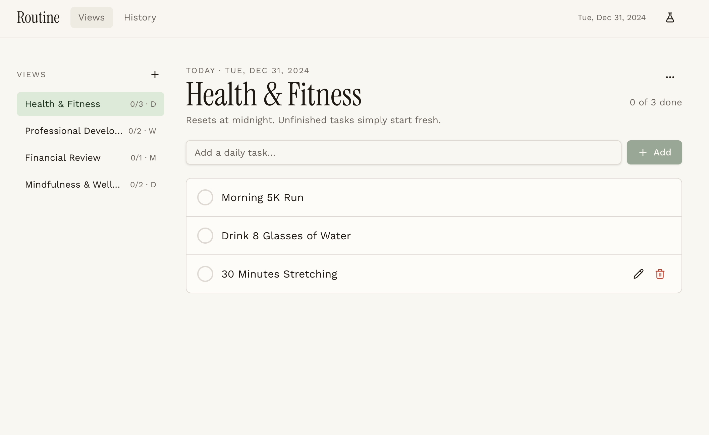
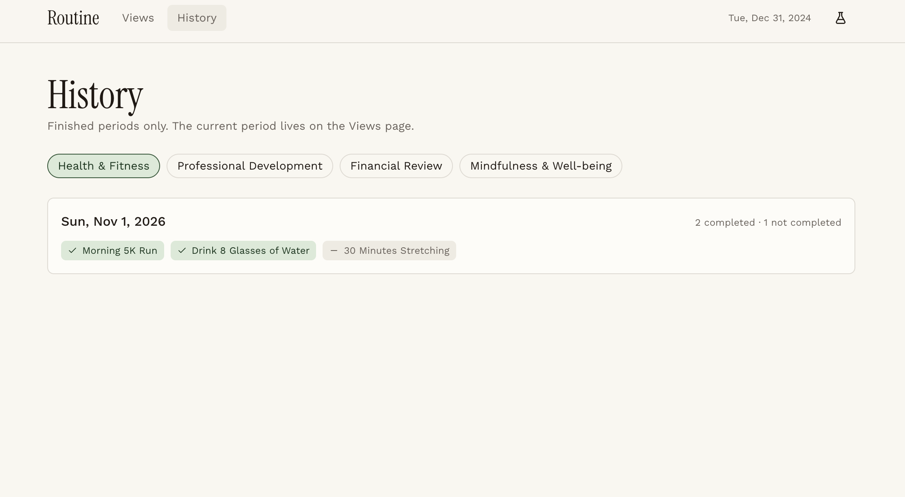
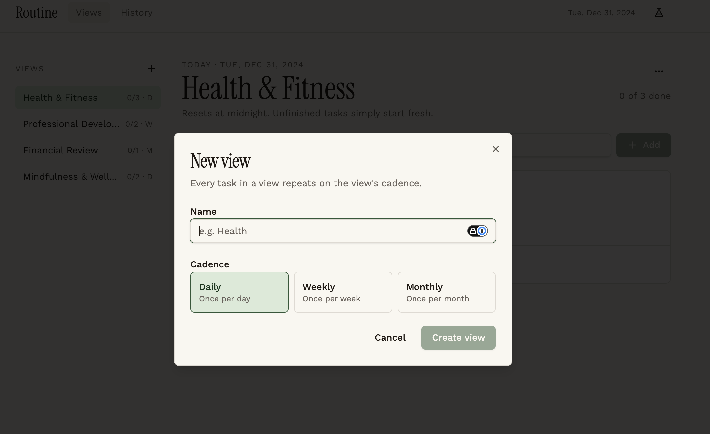

# Routine Tracker

A modular, canvas-based habit tracker designed around flexible daily, weekly, and monthly cadences. Routines are organized into interactive, single-purpose tracking windows living on a freeform board space. Users can flip cards over to inspect historical consistency over time and leverage data-driven insights to build sustainable habit stacks and correlate daily well-being with established routines.

---

## 🚀 Application Demonstration (App Demo) 🦖

The Routine Tracker interface provides an interface for organizing and tracking daily, weekly, and monthly habits:







---

## 🚀 Getting Started & Local Development 🦖

Follow these steps to set up and run Routine Tracker locally.

### Prerequisites
- **Python (>= 3.10)** with **uv** installed for backend package management.
- **Bun** (>= 22.0.0 / 1.4.4+) installed for frontend package management.

### 1. Install Dependencies
Install dependencies for both backend and frontend from the repository root:
```bash
# Install backend dependencies
make backend-install
# or: uv sync

# Install frontend dependencies
make frontend-install
# or: bun --cwd frontend install
```

### 2. Seed the Database
Populate the SQLite database (`dev.db`) with initial test users, views, tasks, and completion logs:
```bash
make backend-seed
# or: uv run python -m backend.seed
```
*(Note: Seeding resets the database by dropping existing tables and recreating them with fresh test data).*

### 3. Run the Application Locally
Run the backend and frontend development servers in two separate terminal windows from the repository root:

* **Terminal 1: Backend Server**
  ```bash
  make backend-dev
  # or: uv run uvicorn backend.main:app --reload
  ```
  The Python FastAPI backend application programming interface (API) is available at `http://localhost:8000` (with interactive documentation at `/docs`).

* **Terminal 2: Frontend Development Server**
  ```bash
  make frontend-dev
  # or: bun --cwd frontend run dev -- --host
  ```
  The Vite frontend development server is available at `http://localhost:5173`.

### 4. Running Tests
* **Backend Tests:**
  ```bash
  make backend-test
  # or: uv run pytest
  ```
* **Frontend Tests:**
  ```bash
  make frontend-test
  # or: bun --cwd frontend test
  ```

---

## 🚀 Project Structure 🦖

The repository is organized into a modular backend-frontend architecture:

```text
/workspaces/routine-tracker/
├── backend/              # Python FastAPI backend API and routers
│   ├── models/           # SQLAlchemy Object-Relational Mapper (ORM) models (Task, User, View, CompletionLog)
│   ├── routers/          # API endpoint routers (auth, tasks, views, clock, history)
│   └── tests/            # Pytest test suite
├── frontend/             # React + Vite frontend application (TanStack Router, shadcn/ui)
│   └── src/
│       ├── components/   # User Interface (UI) components and routine widgets
│       ├── hooks/        # React Query hooks and custom state logic
│       ├── lib/          # Period calculations, error handling, and utilities
│       └── routes/       # File-based routing (index, history, login)
└── _docs/                # Architecture specifications, Architecture Decision Records (ADRs), and agent roles
```

---

## 🚀 Deployment 🦖

- **Database:** SQLite (`dev.db`) for local development, with SQLAlchemy ORM abstraction supporting PostgreSQL for production deployment.
- **Backend:** Python FastAPI server container or service deployment.
- **Frontend:** Static asset build generated via Vite (`bun run build`), deployable on modern static hosting platforms or served alongside the backend.

---

## 🚀 Repository Automations 🦖

Routine Tracker utilizes a standardized `Makefile` to orchestrate build, development, and testing workflows:

- **Dependencies:** `make backend-install` (`uv sync`) and `make frontend-install` (`bun install`).
- **Development Servers:** `make backend-dev` (FastAPI with reload) and `make frontend-dev` (Vite dev server).
- **Database Seeding:** `make backend-seed` (`uv run python -m backend.seed`).
- **Test Suites:** `make backend-test` (`uv run pytest`) and `make frontend-test` (`bun test`).
- **Code Quality:** Frontend linting (`make frontend-lint`) and formatting (`make frontend-format` with Prettier).

---

## 🤖 AI-Native Development & Agentic Workflow

This project is built using an intentional, structured artificial intelligence (AI)-native development methodology, treating AI coding agents as specialized team members rather than general-purpose code generators. The workflow maximizes resource efficiency, maintains architectural rigor, and prevents agent drift through strict guardrails. See `_docs/ai_usage_report.md` for more details.

## ROADMAP

Review repository after a few months to measure progress. 
Use specialized agents for security reviews, testing reviews, and code refactoring.
