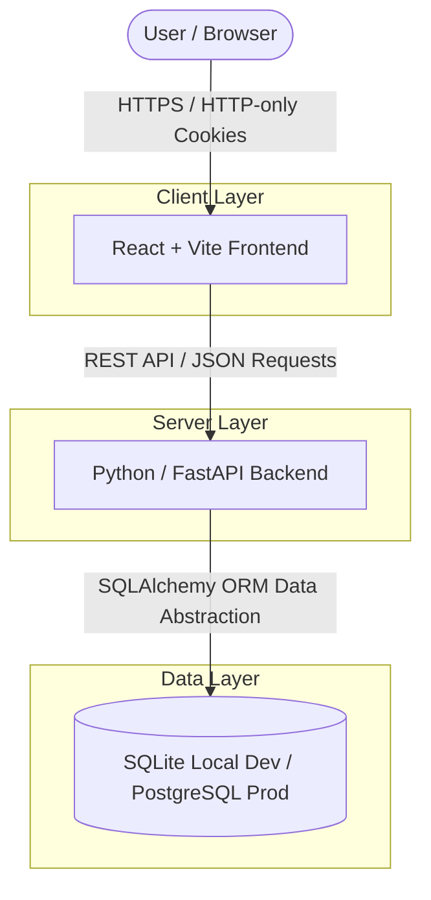

# System Architecture: Routine Tracker MVP

## Purpose
This document provides a comprehensive technical overview of the Routine Tracker MVP architecture. It is designed to serve two distinct audiences:
1. **Human Developers & Reviewers:** Providing a clear, high-level map of how system layers interact.
2. **AI Coding Agents:** Explicitly defining the technology stack, system boundaries, data flow, and communication protocols so an agent can reason about the codebase without needing to infer missing context.

---

## High-Level Architecture Diagram

---

## Component Specifications & Stack Details

### 1. Client Layer (Frontend)
* **Technology:** React (component-driven library) built and bundled using Vite.
* **Role:** Renders the user interface, manages local UI state, and communicates with the backend via asynchronous HTTP requests.
* **Communication Protocol:** RESTful API requests carrying JSON payloads. Authentication credentials are automatically included via secure, HTTP-only cookies managed by the browser.

### 2. Server Layer (Backend)
* **Technology:** Python utilizing FastAPI.
* **Role:** Exposes REST API endpoints, handles business logic, enforces authentication/authorization rules, and coordinates database transactions.
* **API Documentation:** Automatically generates OpenAPI / Swagger documentation out-of-the-box.

### 3. Data Layer (Database & ORM)
* **Technology:** SQLite (local development) paired with PostgreSQL (production target), abstracted via an Object-Relational Mapper (ORM).
* **Role:** Manages persistent storage for users, habits, and completion tracking logs.
* **Design Constraint:** All database interactions must flow through the ORM abstraction layer to ensure seamless transition between the local SQLite file and the production PostgreSQL instance.

---

## Security & Authentication Architecture
* **Mechanism:** JSON Web Tokens (JWTs) for session representation.
* **Storage:** Stored exclusively in secure, **HTTP-only cookies** set by the FastAPI backend upon successful authentication.
* **Agent Rule:** Client-side JavaScript must never have direct read or write access to authentication tokens (no local storage token caching), protecting against cross-site scripting (XSS) token exposure.
